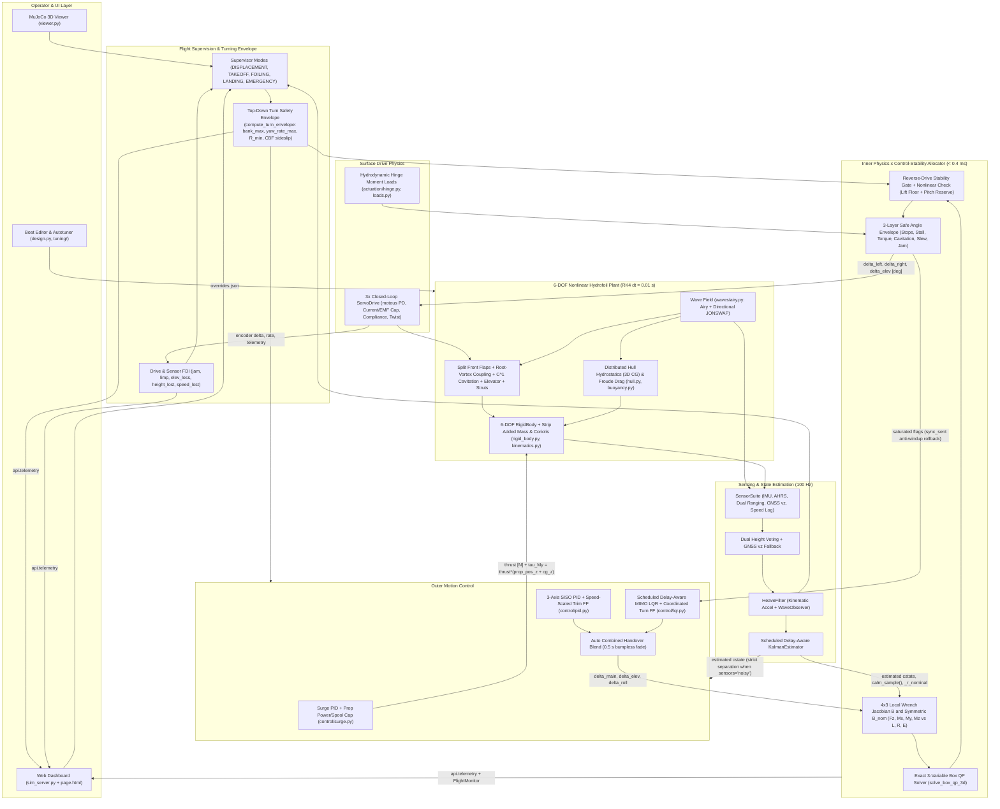

# 00 — Master System Architecture

This document is the end-to-end architectural reference for the 6-DOF hydrofoil simulator. It covers the full closed-loop signal chain from user input through flight supervision, estimation, outer control, physics-constrained Jacobian control allocation, servo drive dynamics, 6-DOF hydrodynamics, and browser/3D telemetry.

---

## 1. End-to-End Closed-Loop Block Diagram

### Mermaid System Flowchart



---

### ASCII Closed-Loop Architecture Diagram

```
  +----------------------+      HTTP / JSON (8765/8766)       +-------------------------------+
  |  Web Dashboard       | <----------------------------------> |  MuJoCo 3D Viewer & ControlAPI|
  |  (sim_server.py +    |   telemetry: alloc, turn_envelope,   |  (viewer.py, 60 fps render,   |
  |   page.html)         |   drives, supervisor, sigma, vent    |   100 Hz physics loop)        |
  +----------+-----------+                                      +---------------+---------------+
             |                                                                  |
             | pilot / yaw_rate / safety_margin / allocator / reverse_drive     | stick / keys / UI
             v                                                                  v
  +---------------------------------------------------------------------------------------------+
  |                      Flight Supervisor & Top-Down Turn Envelope (supervisor.py)             |
  |  Modes: DISPLACEMENT -> TAKEOFF -> FOILING -> LANDING / EMERGENCY_LANDING                   |
  |  Turn Safety: bank_max(u, h, wave, preset, eta_turn), yaw_rate_max, R_min, active CBF unwind|
  |  FDI: dual height voting, rate-compensated drive residual -> jam / limp / elev_loss         |
  +----------------------------------+----------------------------------------------------------+
                                     | clamped refs (z_ref, phi_ref, speed_ref) & jam state
                                     v
  +---------------------------------------------------------------------------------------------+
  |                              Outer Motion Control Stack                                     |
  |                                                                                             |
  |  [ ideal OR SensorSuite -> HeaveFilter + KalmanEstimator (no-cheat boundary) ]              |
  |        |                                                                                    |
  |        +---> SISO PID + 1/u^2 Trim FF (Takeoff / Landing) ----+                             |
  |        |                                                      +--> Auto Combined Blend      |
  |        +---> Scheduled Delay-Aware LQR + Turn FF (Foiling) ---+    (0.5 s bumpless fade)    |
  |        |        ^                                                       |                   |
  |        |        | sync_sent(sat_flags) anti-windup rollback             |                   |
  |        +---> Surge PID + Propeller Power/Spool Limiter ---> Thrust [N]  | (main, elev, roll)|
  +-------------------------------------------------------------------------+-------------------+
                                                                            v
  +---------------------------------------------------------------------------------------------+
  |         Physics x Control-Stability Control Allocator (control/allocator.py)                |
  |         Uses calm_sample() + vent={} + _r_nominal when sensors == 'noisy'                   |
  |                                                                                             |
  |  1. Build 4x3 Local Jacobian B = d[Fz, Mx, My, Mz] / d[L, R, E] + cross-coupling + B_nom    |
  |     (with T-foil elevator-heave QP decoupling B[0][2] = B_nom[0][2] = 0.0)                  |
  |  2. Layer 1/2 Bounds [lo, hi] per flap: Mech Stops, Cmd Env, Asymmetric Stall,              |
  |     V^2 Servo Hinge Torque, Cavitation (closed-form sigma/Cp_min), Slew Rate, Jam Lock      |
  |  3. Solve Exact 3-Var Box QP:  min 0.5 || W (B du - dw_des) ||^2 + reg || du - du_nom ||^2  |
  |  4. Reverse-Drive Stability Gate + Exact Nonlinear Evaluation (Lift Floor & Elev Reserve)   |
  +----------------------------------+----------------------------------------------------------+
                                     | delta_left, delta_right, delta_elev [deg]
                                     v
  +---------------------------------------------------------------------------------------------+
  |                 Actuators, Hydrodynamics & 6-DOF Rigid Body (100 Hz RK4)                    |
  |                                                                                             |
  |  ServoDrive (BLDC, gearbox, compliance, backlash, flap twist) <-> true HingeMoment loads    |
  |       | (effective panel angles delta_L, delta_R, delta_E)                                  |
  |       v                                                                                     |
  |  Foil Strip Theory (NACA 0009 bisect polar, separation, free-surface, ventilation, C^1 cav) |
  |    + Left/Right Front Flaps (y = +-y_lat, root-vortex coupling) + Rear Elevator (downwash)  |
  |    + Vertical Struts (sway/yaw added mass, sideslip ventilation) + 3D CG Hull & Prop z-arm  |
  |       | (Net 6-DOF Wrench tau = [X, Y, Z, K, M, N])                                         |
  |       v                                                                                     |
  |  RigidBody 6-DOF Dynamics (nu_dot = M^-1 (tau - C(nu) nu)) -> Kinematics eta_dot = J nu      |
  +---------------------------------------------------------------------------------------------+
```

---

## 2. Module Responsibility Map

| Subpackage / File | Core Responsibility |
|---|---|
| `hydrofoil/params.py` | Baseline `DEFAULT_PARAMS` (25 kg model) and `MANNED_PARAMS` (275 kg craft), control mode, allocator, safety preset, and hardware bounds |
| `hydrofoil/constants.py` | Physical constants (`RHO_WATER = 1025.0 kg/m^3`, `G = 9.81 m/s^2`) |
| `hydrofoil/dynamics/kinematics.py` | ZYX Euler rotation `R_body_to_ned`, closed-form rate matrix `T_euler`, 6-DOF kinematic Jacobian `J(eta)` |
| `hydrofoil/dynamics/rigid_body.py` | `RigidBody` 6-DOF mass + strip added mass (`heave`, `pitch`, `roll`, `sway`, `yaw`) and passive skew-symmetric Coriolis/centripetal `C(nu)` |
| `hydrofoil/waves/airy.py` | Monochromatic `AiryWave`, directional JONSWAP `IrregularWave`, `encounter_frequency()`, and `CalmWater` |
| `hydrofoil/forces/buoyancy.py` | Gravity 6-DOF wrench transformed to body frame |
| `hydrofoil/forces/hull.py` | Distributed planing hull hydrostatics (`HullHydrostatics` 3D `set_cg_offset(dx, dy, dz)`) and wetted Froude hump + lateral/rotational damping |
| `hydrofoil/forces/foil.py` | Fast `bisect`-indexed `FoilTables`, `cavitation_number`, `cp_min_and_slope`, `effective_flap_and_slope`, active $C^1$ cavitation (`cavitation_model=True`), `Foil.generalized_force`, and `Foil.local_derivatives` |
| `hydrofoil/actuation/` | Thin-airfoil `HingeMoment` (`hinge.py`), BLDC/gearbox `DriveSpec` (`drive.py`), closed-loop `ServoDrive` (`servo.py`), flow load wrappers with optional nominal CG overrides (`loads.py`) |
| `hydrofoil/sensors/models.py` | Delayed, rate-limited, noisy MEMS/ranging/GNSS `SensorSuite` |
| `hydrofoil/estimation/kalman.py` | Wave-decoupled kinematic `HeaveFilter` + speed-scheduled steady `KalmanEstimator` |
| `hydrofoil/control/pid.py` | Conditional-anti-windup 3-axis `HydrofoilController` (takeoff, landing, PID backup) |
| `hydrofoil/control/lqr.py` | Delay-augmented speed-scheduled MIMO `LQRController` with coordinated turn feedforward, `(ch, j)` channel-to-integrator rollback in `sync_sent(..., sat_flags=...)`, and cached plant linearizations |
| `hydrofoil/control/allocator.py` | Physics-constrained `ControlAllocator` (`use_truth` separation, T-foil `B[0][2]=0` elevator-heave decoupling, & exact nonlinear check `_eval_nl`), `solve_box_qp_3d`, `compute_flap_safe_bounds`, `SAFETY_PRESETS`, and stability-gated reverse drive |
| `hydrofoil/control/supervisor.py` | Flight-phase state machine `Supervisor`, standalone `compute_turn_envelope` using plant-derived `vp.turning_efficiency(u)`, active sideslip CBF bank unwinding (`|beta| > 0.80 * beta_max`), and drive/sensor FDI |
| `hydrofoil/control/surge.py` | Longitudinal speed `SurgeController` |
| `hydrofoil/vehicle.py` | Canonical `VehiclePhysics` orchestrator uniting sensors, estimation (no-cheat allocator isolation), 3D `cg_z` + `prop_pos_z` thrust moment, lazily cached `turning_efficiency(u)`, servos, active cavitation, ventilation hysteresis, and RK4 integration |
| `hydrofoil/design.py` | Live Boat Editor sizing calculator (`mass_properties`, `apply_design`, `trim_curve`, `_reschedule`, `design_summary`) |
| `hydrofoil/consistency.py` | Static and trim parameter co-dependency audit (`check`, CLI report) |
| `hydrofoil/monitor.py` | Analysis-only `FlightMonitor` generating caution/danger advisories from live state and dynamic allocator/turn bounds |
| `hydrofoil/tuning/` | Relay test (`classical.py`), 8-scenario phase-aware evaluator (`scoring.py`), and background cross-entropy optimizer (`autotune.py`) |
| `hydrofoil/viewer.py`, `hydrofoil/sim_server.py`, `hydrofoil/assets/launcher/page.html` | Native 3D MuJoCo viewer + Pillow HUD + HTTP ControlAPI + Web Dashboard UI |

---

## 3. Coordinate Frame & Sign Conventions

- **Frames:** Fossen (2011) NED world frame ($+x$ North, $+y$ East, $+z$ **Down**); body frame ($+x$ bow/forward, $+y$ starboard, $+z$ **Down**).
- **Attitude:** ZYX Euler angles $[\phi, \theta, \psi]$ in radians internally (`deg` at UI, HTTP API, and controller gain boundaries):
  - $+\phi$: right wing / starboard down roll; $+\theta$: bow up; $+\psi$: bow turning starboard (right).
- **Physical Surfaces & Mixer Sign Alignment:**
  - `left_foil` attaches at $y = -y_{\text{lat}} < 0$ (port); `right_foil` attaches at $y = +y_{\text{lat}} > 0$ (starboard); `elev_foil` attaches aft at $x = -|x_E| < 0, y = 0$.
  - $+\delta_i$ = trailing edge down = more upward lift ($F_z < 0$ in NED):
    - $+\delta_L > 0$ produces $+M_x$ (lifts port wing, rolls right); $+\delta_R > 0$ produces $-M_x$ (lifts starboard wing, rolls left).
    - Symmetric virtual mixer: `left = delta_main - delta_roll`, `right = delta_main + delta_roll`, `elev = delta_elev`.
    - $+\delta_E > 0$ aft produces upward rear lift ($F_z < 0$) and $-M_y$ (pitches nose down).
  - Centerline root-vortex cross-coupling when `delta_L != delta_R`:
    $$\delta_{\text{eff},L} = (1 - k_{cc})\delta_L + k_{cc}\delta_R,\qquad \delta_{\text{eff},R} = (1 - k_{cc})\delta_R + k_{cc}\delta_L$$
    which vanishes identically whenever $\delta_L = \delta_R$.
  - **Front Strut Configuration (`main_strut_count`, `±main_strut_y`):** Single centerline strut (`main_strut_count = 1`, e.g., `model`/`manned`) or true dual front struts (`main_strut_count = 2`, `main_strut_l`/`main_strut_r` at `y = ±main_strut_y`, e.g., `cad` preset), each independently sampling local wave orbital velocity, surface breach/ventilation, sideslip drag, and differential yaw damping $M_z$.
  - **Resilient Speed-Scheduled Estimation (`KalmanEstimator`):** Initializes across `lqr_speeds` while skipping speeds where `trim()` fails or exceeds `limit_deg`, falling back cleanly to `HeaveFilter` + PID loops when no trimmed flight speed exists (e.g., `cad` at `0°` mounting angle).
  - **3D Vertical CG & Thrust Line (`cg_z`, `prop_pos_z`):** Payload vertical coordinate `cg_z` (`+z` UP) shifts all foil/strut `r_attach[2]` (`_r_nominal - [dx, dy, -cg_z]`), shifts `HullHydrostatics` bottom cells and `hull_offset`, and adds propulsion pitching moment `tau[4] += thrust * (prop_pos_z + cg_z)` in `physics_rhs`.

---

## 4. Numerical Hardening & Singularity Protection Summary

| Potential Singularity / Degeneracy | Protection Implemented | Location |
|---|---|---|
| Zero/low speed $V \to 0$ dividing by $q \propto V^2$ or $1/V^2$ | Smooth speed blend $\alpha_{\text{phys}} = \text{clip}((u - 1.5)/1.5, 0, 1)$; $V_{\min}$/dynamic pressure floored at `1e-6` | `control/allocator.py`, `forces/foil.py` |
| `np.arccos(rhs / r)` FP overshoot `±(1 + 1e-16)` | Clamped to `np.clip(rhs / r, -1.0, 1.0)` inside `_solve_cos_sin` | `control/supervisor.py` |
| Rank-deficient LQR turn sensitivity (`M_eq`, `B_lon`) | `try ... except LinAlgError` falling back to `np.linalg.lstsq` / `pinv` | `control/lqr.py` |
| Singular trim Jacobian `J` in Boat Editor edits | Damped Levenberg–Marquardt normal solve `(J^T J + 1e-4 I)^-1 (-J^T r)` | `linearize.py` |
| Singular Hessian / flat box bounds in 3-var QP | Scale-invariant `1e-8 * trace(H)/3 * I` ridge + `1e-18` determinant guards + 27-face exact fallback | `control/allocator.py` |
| Collapsed dimensions, missing payload keys, zero `w0` | Positive geometry floors, `_sanitize_payloads`, `w0` guard, duplicate-timestamp guard | `forces/foil.py`, `actuation/hinge.py`, `design.py`, `estimation/kalman.py`, `monitor.py` |

---

## 5. Backend-to-Frontend Telemetry Contract (`ControlAPI /state` → `page.html`)

Every core backend subsystem is streamed over `http://127.0.0.1:8766/state` (and writable controls accepted via `POST /set`) so no safety state or failure flag remains hidden from the operator:

| Field | Producer | Frontend Consumer (`page.html`) |
|---|---|---|
| `geom`, `wave`, `foil_depth_hc`, `cp_min_max`, `power_kw` | `viewer.py` (`api.telemetry`, `encounter_frequency`) | Split Fly Hero: Side Elevation (`#side` with cockpit box & wing incidence) + Top-Down Turning & Oblique Waves (`#topView` with planform flaps, `R_min`/`R_now` arcs, animated wave crests at relative angle `μ`, compass `ψ`) + `#gd` (`h/c`), `#gcav` (`σ` vs `|Cp_min|`), `#gwav` (`T_e`, `μ`), `#gnav` (`ψ`, `β`, `r`) |
| `alloc` | `ControlAllocator.allocate()` | Independent Front Flaps range bars, live safe `[lo, hi]` bands, dynamic mechanical/command `stops`, binding tags, reverse-drive status pill, `Δδ`, `solve_ms`, lift margin, pitch reserve |
| `turn_envelope` | `compute_turn_envelope()` / `Supervisor` | Top-Down Turn Safety SVG (`#turnSvg` with `R_min` port/starboard dashed boundary circles & live trajectory arc), heading `ψ` (`yaw`), `r_max`, `R_min`, `β/β_max`, `lat_g/cap`, binding constraint |
| `supervisor` | `Supervisor.status` | Mode badge, estimated wave amplitude $A_w$, jammed-flap state, active faults/warnings, and persistent `sup.log` transition/fault history |
| `drives` | `ServoDrive.telemetry` / `DriveMonitor` | Per-drive Torque ($M$), live torque limit `cap` & `% load`, Current ($I$), Power ($P$), and `LIMITED` status badge |
| `cavitation_sigma`, `ventilation` | `VehiclePhysics` / `ControlAllocator` | Live cavitation number $\sigma$ (all modes/allocators) and L / R / Elev / Strut ventilation percentages |
| `height_status` | `VehiclePhysics._control_state()` | Dual height channel health (`height`, `height_aux`) and `GNSS vz` fallback indicator |
| `controller_detail` | `VehiclePhysics.controller_status()` | Mode badge, active controller share, handover blend bar, plain-English reason |
| `alerts`, `alert_log` | `FlightMonitor` | Severity alert feed + persistent event log |
| Live toggles (`POST /set`) | `ControlAPI.do_POST` → `Pilot` | Live `safety_margin`, `allocator`, `reverse_drive`, `controller_mode`, `wave_type` (`regular`/`irregular`), `unit`, `yaw_rate_cmd`, and helm sliders |
